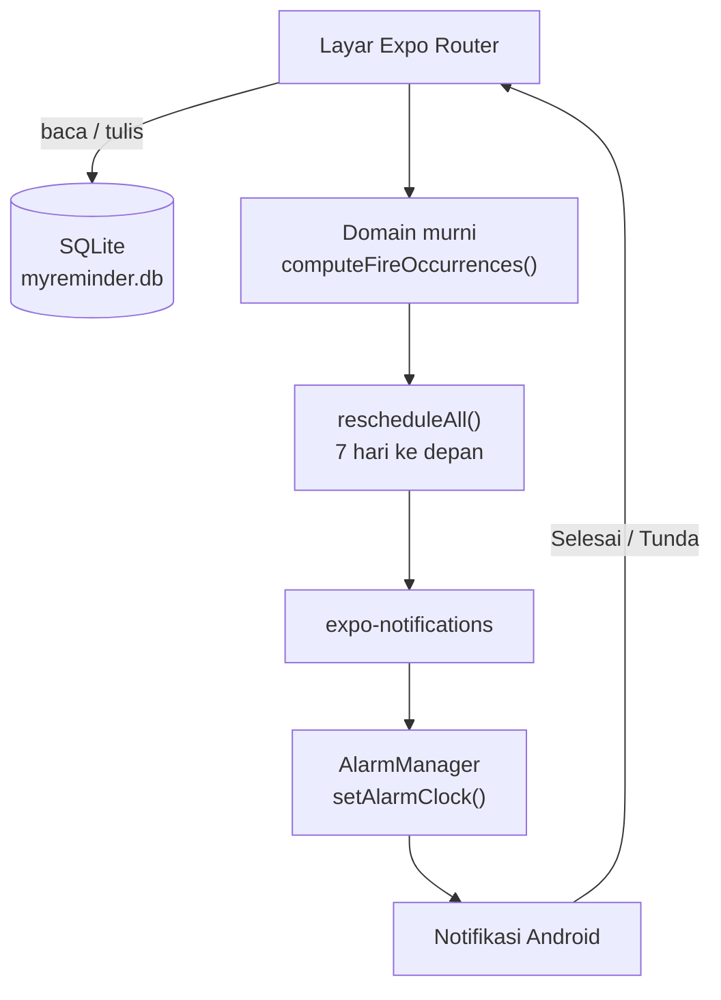

<p align="center">
  
</p>

<h1 align="center">myReminder</h1>

<p align="center">
  <strong>Reminder, tugas, dan jadwal mapel — sepenuhnya offline.</strong><br />
  <sub>Satu mesin pengingat, tiga tampilan. Tanpa akun, server, atau sinkronisasi.</sub>
</p>

<p align="center">
  
  
  
  
  
  
  
</p>

<p align="center">
  <sub>Dibuat untuk dipakai sehari-hari di HP sendiri — bukan untuk toko aplikasi.</sub>
</p>

---

**myReminder** adalah aplikasi pengingat pribadi untuk Android yang bekerja **100% offline**. Semua data disimpan di SQLite di HP; aplikasi tidak mengirim request jaringan, tidak butuh login, dan tidak bergantung pada layanan pihak ketiga.

Satu model `Item` dipakai untuk tiga hal: **tugas**, **acara kalender**, dan **jadwal mapel**. Semua memakai mesin pengingat yang sama, sehingga aturan “sebelum”, “berulang”, dan “malam sebelumnya” bisa dipakai di mana saja.

---

## Daftar isi

- [Kenapa myReminder](#kenapa-myreminder)
- [Fitur](#fitur)
- [Cara pakai singkat](#cara-pakai-singkat)
- [Pasang APK di HP](#pasang-apk-di-hp)
- [Development](#development)
- [Build APK release](#build-apk-release)
- [Notifikasi di Android](#notifikasi-di-android)
- [Arsitektur](#arsitektur)
- [Database](#database)
- [Navigasi](#navigasi)
- [Tes dan kualitas](#tes-dan-kualitas)
- [Troubleshooting](#troubleshooting)
- [Batasan](#batasan)
- [Struktur folder](#struktur-folder)
- [Versi](#versi)
- [Lisensi](#lisensi)

---

## Kenapa myReminder

- **Offline total.** Mode pesawat tetap normal; tidak ada API, akun, atau cloud.
- **Satu mesin, tiga tampilan.** Tugas, acara, dan mapel memakai model dan penjadwal yang sama.
- **Notifikasi yang serius.** Exact alarm, `setAlarmClock()`, channel importance tinggi, dan aksi Selesai/Tunda.
- **Bahasa Indonesia.** Seluruh teks antarmuka berbahasa Indonesia; kode, identifier, dan komentar berbahasa Inggris.
- **Data milik sendiri.** SQLite lokal, tanpa telemetry.

---

## Fitur

### 📝 Tugas

- Judul, catatan, prioritas (rendah/normal/tinggi), dan deadline opsional.
- Tugas tanpa deadline tetap bisa punya pengingat berulang untuk hal seperti “minum air” atau “istirahat”.
- Daftar otomatis mengurutkan tugas terbuka, prioritas, deadline, lalu judul.
- Tandai selesai langsung dari daftar. Tugas selesai tidak lagi menjadwalkan notifikasi.

### ⏰ Pengingat

- **Sebelum** — N menit/jam/hari/minggu sebelum deadline atau jam mulai mapel.
- **Berulang** — setiap X menit/jam/hari/minggu, berhenti sendiri setelah N kali.
- **Malam sebelumnya** — khusus mapel, misalnya pukul 20:00 sehari sebelum kelas.
- Satu item boleh punya beberapa aturan sekaligus.
- Notifikasi punya aksi **Selesai** dan **Tunda**. Durasi tunda bisa diubah di Pengaturan.
- Notifikasi mapel hanya punya aksi **Tunda**; mapel ditandai selesai dengan mematikan saklar aktif.

### 🏫 Jadwal mapel

- Nama mapel, hari, jam mulai/selesai, ruangan, dan guru.
- Diulang setiap minggu tanpa perlu membuat ulang.
- Saklar aktif/nonaktif per mapel untuk libur panjang.
- Mode libur global untuk menjeda semua notifikasi mapel sekaligus.

### 🗓️ Kalender

- Tampilan bulanan, minggu dimulai Senin.
- Hari yang punya tugas, acara, atau mapel diberi tanda.
- Acara bisa memakai jam atau seharian.
- Mengetuk tanggal membuka agenda hari itu; tombol tambah langsung mengisi tanggal tersebut.

### 🎨 Tampilan dan data

- Mode terang/gelap mengikuti sistem.
- Palet indigo/ink, target sentuh besar, haptic feedback, dan date/time picker native.
- Data bertahan setelah aplikasi ditutup atau HP restart.
- Layar **Panduan** berisi langkah izin notifikasi, exact alarm, baterai, autostart, layar kunci, dan kunci recent apps.
- Layar **Diagnostik** menampilkan izin, channel, jumlah item, dan notifikasi yang sedang terjadwal.

---

## Cara pakai singkat

1. Buka tab **Tugas** untuk melihat ringkasan dan daftar tugas.
2. Ketuk tombol **+** untuk membuat tugas, acara, atau mapel.
3. Di form, tambahkan satu atau beberapa aturan pengingat.
4. Buka tab **Jadwal** untuk melihat mapel per hari.
5. Buka tab **Kalender** untuk melihat sebaran item dalam bulan.
6. Buka tab **Atur** untuk izin, durasi tunda, mode libur, panduan, dan diagnostik.

Saat pertama kali memakai aplikasi, izinkan notifikasi. Kalau izin ditolak, aplikasi tetap bisa dipakai dan menampilkan penjelasan, bukan crash.

---

## Pasang APK di HP

APK release ada di:

```text
dist/myreminder-1.0.0.apk
```

### Lewat kabel USB

```bash
adb install -r dist/myreminder-1.0.0.apk
```

Jika muncul `INSTALL_FAILED_UPDATE_INCOMPATIBLE`, APK baru ditandatangani dengan kunci berbeda dari versi yang terpasang. Pilih salah satu:

- Build ulang memakai keystore yang sama, atau
- Uninstall versi lama terlebih dahulu. **Data lokal akan hilang** karena belum ada fitur ekspor/impor.

### Tanpa kabel

1. Salin APK ke HP (USB, Google Drive, atau file manager).
2. Buka file APK.
3. Izinkan “Instal dari sumber tidak dikenal” untuk aplikasi file manager yang dipakai.
4. Ikuti proses instalasi.

APK ini dibangun untuk **arm64-v8a**, arsitektur yang dipakai Realme C25s dan hampir semua HP Android modern. Kalau perangkat lain memakai arsitektur berbeda, build ulang dengan daftar arsitektur yang sesuai.

### Catatan signing

Build release lokal memakai `android/app/debug.keystore` bawaan Expo. Ini cukup untuk pemakaian pribadi, tetapi:

- **Cadangkan** `android/app/debug.keystore` di tempat aman.
- Update berikutnya harus ditandatangani dengan kunci yang sama.
- Jangan uninstall aplikasi sebelum yakin data tidak diperlukan.
- Untuk distribusi publik, buat keystore release sendiri dan jangan memakai keystore debug.

---

## Development

### Prasyarat

- Node.js LTS dan npm
- JDK 17
- Android SDK dengan Platform 36 dan Build-Tools 36.0.0
- `ANDROID_HOME` dan `platform-tools` ada di `PATH`
- HP Android dengan USB debugging, atau emulator

```bash
npm install
npx expo start
```

Untuk build native di HP/emulator:

```bash
npx expo run:android
```

Perintah pemeriksaan:

```bash
npx tsc --noEmit       # typecheck
npx expo lint          # lint
npm test -- --runInBand
npx expo export --platform android
npx expo-doctor
```

> Gunakan `npx expo install <paket>` saat menambah library Expo agar versinya cocok dengan SDK. Jangan menebak versi.

### Teknologi

| Lapisan | Teknologi |
|---|---|
| Framework |   |
| Bahasa |  |
| Navigasi |  |
| Data |   |
| Notifikasi |  |
| Tanggal |  |
| Tes |  |
| Lint |  |
| Build |   |

### Struktur pengembangan

- `src/app/` berisi route Expo Router. Setiap file di sini adalah layar.
- `src/domain/` berisi logika murni tanpa React, Expo, atau SQLite.
- `src/db/` berisi koneksi, migrasi, dan query SQLite.
- `src/notifications/` berisi channel, izin, penjadwalan, dan aksi notifikasi.
- `src/components/` berisi komponen UI dan komponen layar.
- `src/theme/` berisi token warna dan provider tema.
- `android/` dan `ios/` adalah folder hasil generate. Jangan diedit manual; ubah lewat `app.json` dan config plugin, lalu `npx expo prebuild`.

---

## Build APK release

Pastikan SDK Android sudah terpasang:

```bash
sdkmanager "platforms;android-36" "build-tools;36.0.0"
```

Generate ulang folder native setelah mengubah `app.json`, plugin, atau dependensi native:

```bash
npx expo prebuild --platform android --clean
```

Build APK untuk Realme C25s (arm64):

```bash
cd android
./gradlew :app:assembleRelease -PreactNativeArchitectures=arm64-v8a --max-workers=2
```

Hasil build:

```text
android/app/build/outputs/apk/release/app-release.apk
```

Salin ke folder distribusi:

```bash
mkdir -p ../dist
cp app/build/outputs/apk/release/app-release.apk ../dist/myreminder-1.0.0.apk
```

Kalau ingin APK universal untuk beberapa arsitektur:

```bash
./gradlew :app:assembleRelease
```

Build pertama bisa memakan waktu belasan menit dan RAM besar. Tutup browser/aplikasi berat. Jika Gradle kehabisan memori, naikkan `org.gradle.jvmargs` di `android/gradle.properties` atau batasi arsitektur seperti contoh di atas.

> `expo prebuild --clean` menghapus folder `android/`, termasuk `debug.keystore`. Cadangkan dulu keystore-nya sebelum menjalankan perintah ini.

### Fallback EAS

Kalau build lokal tidak memungkinkan, build cloud bisa dipakai:

```bash
npx eas-cli@latest build --platform android --profile production
```

EAS memerlukan akun Expo dan konfigurasi `eas.json`. Untuk pemakaian pribadi, build lokal lebih sederhana karena APK langsung tersedia di laptop.

---

## Notifikasi di Android

Notifikasi lokal di Android bisa diperlambat atau dihentikan oleh sistem. Aplikasi sudah menyiapkan channel importance tinggi, izin Android 13, exact alarm, dan `setAlarmClock()`, tetapi pengaturan HP tetap perlu dicek sekali.

### Yang perlu diizinkan

1. **Notifikasi** — izin dasar Android 13.
2. **Alarm & pengingat** — izin exact alarm agar jadwal tidak digeser beberapa menit. Di Android 13+ aplikasi mendeklarasikan `USE_EXACT_ALARM` sehingga izin ini aktif otomatis; di Android 12 izinnya ada di **Pengaturan → Aplikasi → Akses khusus → Alarm & pengingat**.
3. **Baterai tidak dibatasi** — Info aplikasi → Baterai → Tidak dibatasi / Izinkan aktivitas latar belakang.
4. **Autostart** — Realme/ColorOS: Pengaturan → Baterai → Peluncuran aplikasi → myReminder.
5. **Kunci recent apps** — tarik kartu myReminder ke bawah atau ketuk ikon kunci di daftar aplikasi terakhir.
6. **Layar kunci** — Pengaturan → Notifikasi → myReminder → Layar kunci → “Tampilkan isi”, supaya notifikasi terlihat sebelum HP dibuka.

Layar **Atur → Panduan pengaturan HP** memandu langkah ini dan menyediakan tombol ke pengaturan sistem.

### Tes notifikasi

Buka **Atur → Kirim notifikasi tes (10 detik)**, lalu kunci HP. Notifikasi seharusnya muncul sekitar 10 detik kemudian. Notifikasi tes memakai jalur `setAlarmClock()` yang sama dengan reminder asli, jadi hasilnya bisa dipercaya. Cara yang sama tersedia di layar Panduan dan Diagnostik.

### Perilaku yang perlu dipahami

- **Reminder memakai `setAlarmClock()`** — alarm bangun sendiri dari Doze dan tidak ditunda kebijakan baterai OEM. Karena itu ikon alarm kecil muncul di status bar selama ada reminder terjadwal.
- **App di-swipe dari recent apps** — alarm tetap berjalan karena dijadwalkan oleh sistem, bukan oleh JavaScript yang terus hidup.
- **HP restart** — `expo-notifications` menyimpan request dan memulihkan alarm setelah HP **pertama kali dibuka kunci**. Android tidak mengirim sinyal boot ke aplikasi biasa selama perangkat masih terkunci, jadi ini batasan sistem, bukan bug. Kalau ada notifikasi yang terlewat, buka aplikasi sekali agar `rescheduleAll()` membangun ulang jadwal dari SQLite.
- **Alarm yang waktunya lewat saat HP mati tidak akan muncul setelah nyala** — tidak ada yang bisa dipulihkan karena waktunya sudah terlewat.
- **Force stop dari Settings** — Android membatalkan semua alarm aplikasi. Ini perilaku normal. Buka aplikasi lagi untuk menjadwalkan ulang.
- **Mode libur** dan **mapel nonaktif** memang menghentikan notifikasi terkait.
- **Tanpa deadline**, aturan “sebelum” tidak punya acuan dan akan ditolak validasi. Gunakan pengingat berulang.
- **Jendela penjadwalan hanya 7 hari** ke depan. Jadwal dibangun ulang setiap aplikasi dibuka, setiap item berubah, dan setelah aksi notifikasi.
- **Batas 200 notifikasi** diterapkan agar tidak menabrak batas alarm Android. Sisa notifikasi di luar batas akan dijadwalkan pada pembangunan berikutnya.

Tidak ada aplikasi yang bisa menjamin notifikasi 100% jika produsen HP mematikan aplikasi secara paksa. Pengaturan di atas adalah cara paling andal untuk pemakaian pribadi.

---

## Arsitektur



### Satu item, tiga tampilan

Semua data memakai satu model `Item`:

```ts
type ItemType = 'task' | 'event' | 'class';

interface Item {
  id: string;
  type: ItemType;
  title: string;
  note: string;
  priority: 'low' | 'normal' | 'high';
  dueAt: number | null;
  allDay: boolean;
  schedule: ClassSchedule | null;
  room: string | null;
  teacher: string | null;
  enabled: boolean;
  done: boolean;
  rules: ReminderRule[];
}
```

- `task` memakai `dueAt` opsional.
- `event` wajib punya `dueAt`; `allDay` menentukan apakah jam ditampilkan.
- `class` memakai `schedule` (hari + menit mulai/selesai), bukan tanggal.

### Logika murni

`src/domain/schedule.ts` tidak meng-import React, Expo, atau SQLite. Fungsi utamanya:

```ts
computeFireTimes(item, fromMs, toMs): number[]
computeFireOccurrences(item, fromMs, toMs): FireOccurrence[]
```

Fungsi ini hanya menghitung waktu bunyi. Penjadwalan nyata dilakukan di `src/notifications/scheduler.ts`, sehingga logika bisa dites di laptop tanpa HP.

### Database adalah sumber kebenaran

Notifikasi yang terjadwal bisa hilang karena force stop, update sistem, atau bug. Karena itu:

```text
SQLite → hitung ulang 7 hari → batalkan semua notifikasi → jadwalkan ulang
```

`rescheduleAll()` idempotent dan aman dipanggil berkali-kali. Notifikasi **tidak** dianggap sebagai database.

### Alur notifikasi

1. `NotificationBridge` memantau perubahan item dan app state.
2. `rescheduleAll()` membaca item dari SQLite.
3. `computeFireOccurrences()` menghasilkan waktu bunyi dan jenis aturan.
4. `expo-notifications` menjadwalkan trigger tanggal dengan `delivery: 'alarmClock'`.
5. Saat aksi **Selesai** atau **Tunda** ditekan, Android membuka aplikasi lewat `NotificationForwarderActivity`, lalu listener foreground menangani responsnya. Tombol memakai jalur ini karena ColorOS membuang broadcast background untuk aksi notifikasi.
6. Aksi **Selesai** menandai item selesai; **Tunda** menjadwalkan satu notifikasi baru.
7. Setelah aksi, jadwal dibangun ulang dan daftar item memuat ulang lewat `items-events`.

Task background (`myreminder-notification-action`) tetap didefinisikan di `index.js` dan dipakai untuk notifikasi yang diterima saat aplikasi di belakang. Payload-nya membaca `content.dataString` karena notifikasi terjadwal menyimpan `data` sebagai string JSON.

Notifikasi mapel memakai kategori tanpa tombol Selesai karena satu sesi mapel tidak masuk akal ditandai “selesai” secara permanen.

---

## Database

Database: `myreminder.db` (SQLite lokal).

### Tabel `items`

Menyimpan semua item. Kolom penting:

| Kolom | Isi |
|---|---|
| `id` | ID unik |
| `type` | `task`, `event`, atau `class` |
| `title`, `note` | Teks |
| `priority` | `low`, `normal`, `high` |
| `due_at` | Epoch milidetik atau `NULL` |
| `all_day` | 0/1 |
| `weekday`, `start_min`, `end_min` | Jadwal mapel |
| `room`, `teacher` | Detail mapel |
| `enabled` | 0/1 |
| `done` | 0/1 |
| `rules_json` | JSON array aturan pengingat |
| `created_at` | Epoch milidetik |

### Tabel `settings`

Key-value untuk:

- durasi tunda,
- status mode libur,
- status panduan sudah dilihat.

### Aturan pengingat

```ts
type ReminderRule =
  | { kind: 'before'; offsetMs: number }
  | { kind: 'repeat'; startAt: number; everyMs: number; maxCount: number }
  | { kind: 'eve'; atMinutes: number };
```

Aturan disimpan sebagai JSON di kolom `rules_json`, sehingga bentuk baru bisa ditambahkan tanpa migrasi kolom.

---

## Navigasi

| Route | Isi |
|---|---|
| `/(tabs)` | Daftar tugas |
| `/(tabs)/schedule` | Jadwal mapel per hari |
| `/(tabs)/calendar` | Kalender bulanan |
| `/(tabs)/settings` | Pengaturan |
| `/item/[id]` | Form tambah/edit item |
| `/guide` | Panduan pengaturan HP |
| `/debug` | Diagnostik lokal |

---

## Tes dan kualitas

Tes domain berjalan tanpa React Native atau HP:

```bash
npm test -- --runInBand
```

Cakupan saat ini (38 tes):

- waktu bunyi aturan `before`, `repeat`, dan `eve`,
- batas `maxCount`, item selesai, dan item nonaktif,
- pergantian hari/bulan/tahun pada kalender,
- penandaan hari dan agenda kalender,
- format tanggal/jam Indonesia,
- validasi input dan urutan tugas.

Pemeriksaan lain:

```bash
npx tsc --noEmit
npx expo lint
npx expo export --platform android
npx expo-doctor
```

Tes manual notifikasi tetap perlu dilakukan di HP asli karena perilaku baterai, autostart, dan force stop berbeda tiap produsen.

---

## Troubleshooting

### Notifikasi tidak muncul

1. Buka **Atur** dan pastikan izin notifikasi aktif.
2. Di Android 12+, izinkan **Alarm & pengingat**.
3. Setel baterai ke **Tidak dibatasi** dan aktifkan autostart.
4. Kunci myReminder di recent apps.
5. Pastikan mode libur mati dan mapel tidak dinonaktifkan.
6. Pastikan item punya aturan pengingat yang valid.
7. Untuk aturan “sebelum”, pastikan ada deadline atau jadwal mapel.
8. Buka **Diagnostik** dan tekan **Bangun ulang**.
9. Kirim notifikasi tes 10 detik.
10. Kalau baru force stop, buka aplikasi lagi.

### Notifikasi telat beberapa menit

Biasanya exact alarm belum diizinkan atau baterai masih membatasi. Ikuti panduan di layar **Atur → Panduan pengaturan HP**. Beberapa produsen juga punya pengaturan tambahan seperti “Sleep standby” atau “Ultra battery saver” yang perlu dikecualikan.

### Tombol Selesai/Tunda tidak merespons

Aksi memakai jalur `NotificationForwarderActivity` dan akan membuka aplikasi sebentar. Kalau tombol terlihat “mati”, periksa:

- apakah aplikasi benar-benar terbuka saat tombol ditekan,
- apakah kategori notifikasi sudah terdaftar (buka aplikasi sekali setelah update),
- logcat: `adb logcat -d | grep -iE "expo-notifications|TaskService|ReactNativeJS"`.

### APK gagal dipasang

- Pastikan file tidak rusak dan ukurannya wajar.
- Cek arsitektur: APK ini arm64-v8a.
- Jika tanda tangan berbeda, uninstall versi lama (data hilang) atau build dengan keystore yang sama.
- Aktifkan “Install via USB” di Developer options Realme jika memasang lewat kabel.

### Build Gradle gagal

- Pastikan `ANDROID_HOME` benar dan Platform 36/Build-Tools 36.0.0 terpasang.
- Gunakan JDK 17.
- Jalankan `npx expo prebuild --platform android --clean` setelah mengubah config native.
- Batasi arsitektur: `-PreactNativeArchitectures=arm64-v8a`.
- Tambah memori Gradle jika perlu, lalu hentikan daemon lama: `./gradlew --stop`.

### Data hilang setelah update

Data hanya ada di HP, tanpa backup. Uninstall, clear data, atau pindah perangkat akan menghapus semuanya. Jangan uninstall sebelum yakin.

---

## Batasan

- Android saja; belum ada versi iOS.
- Tidak ada backup, ekspor, impor, atau sinkronisasi cloud.
- Tidak ada widget (sengaja ditunda).
- Libur hanya per mapel atau global; belum ada pengecualian per tanggal.
- Jendela penjadwalan 7 hari dan batas 200 notifikasi.
- Notifikasi tidak bisa dijamin 100% jika sistem mematikan aplikasi secara paksa.
- APK release lokal memakai debug keystore; cocok untuk pemakaian pribadi, bukan distribusi publik.

---

## Struktur folder

```text
myreminder/
├── __tests__/                 # tes domain
├── src/
│   ├── app/                   # route Expo Router
│   │   ├── (tabs)/            # tugas, jadwal, kalender, pengaturan
│   │   ├── item/[id].tsx      # form item
│   │   ├── guide.tsx
│   │   └── debug.tsx
│   ├── components/            # UI, kartu, form, sheet
│   ├── db/                    # SQLite, migrasi, repository
│   ├── domain/                # logika murni + tes
│   ├── hooks/                 # hook data & izin
│   ├── notifications/         # channel, izin, scheduler, aksi
│   ├── settings/              # provider pengaturan
│   └── theme/                 # token terang/gelap
├── assets/images/             # ikon dan splash
├── app.json                   # konfigurasi Expo/Android
├── index.js                   # entry: task notifikasi + expo-router
├── package.json
└── README.md
```

`android/` dihasilkan ulang oleh Expo dan tidak di-commit. `dist/` berisi APK hasil build dan juga tidak di-commit.

---

## Versi

| Komponen | Versi |
|---|---|
| Aplikasi | 1.0.0 |
| Package Android | `com.adikhwan.myreminder` |
| Expo SDK | 58 |
| React Native | 0.88.1 |
| compileSdk / targetSdk | 36 |
| minSdk | 24 (Android 7.0) |
| Bahasa tampilan | Indonesia |
| Kode, identifier, komentar | Inggris |

---

## Lisensi

Dirilis dengan [MIT License](LICENSE).

<p align="center">
  <sub>Dibuat untuk dipakai sendiri, bukan untuk dilupakan.</sub>
</p>
